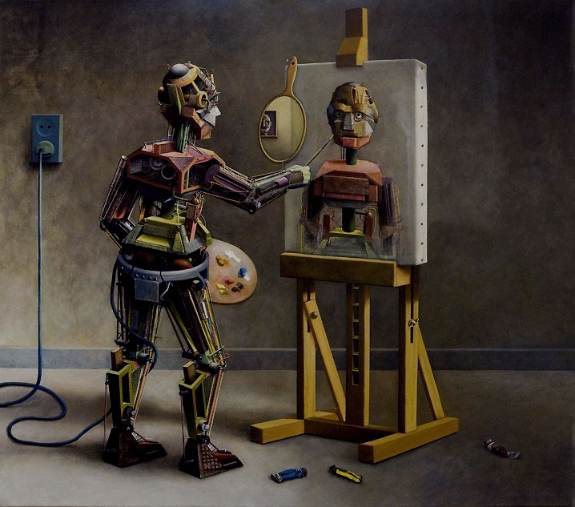
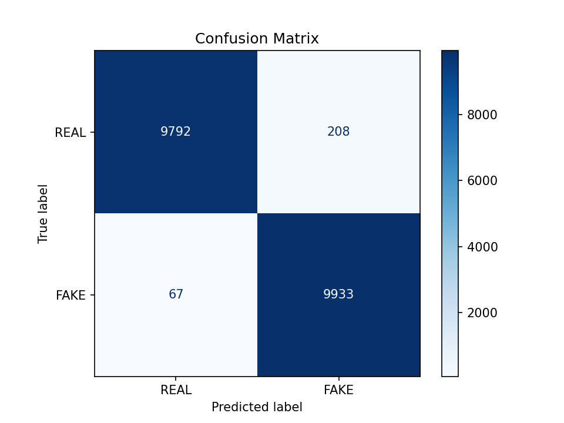
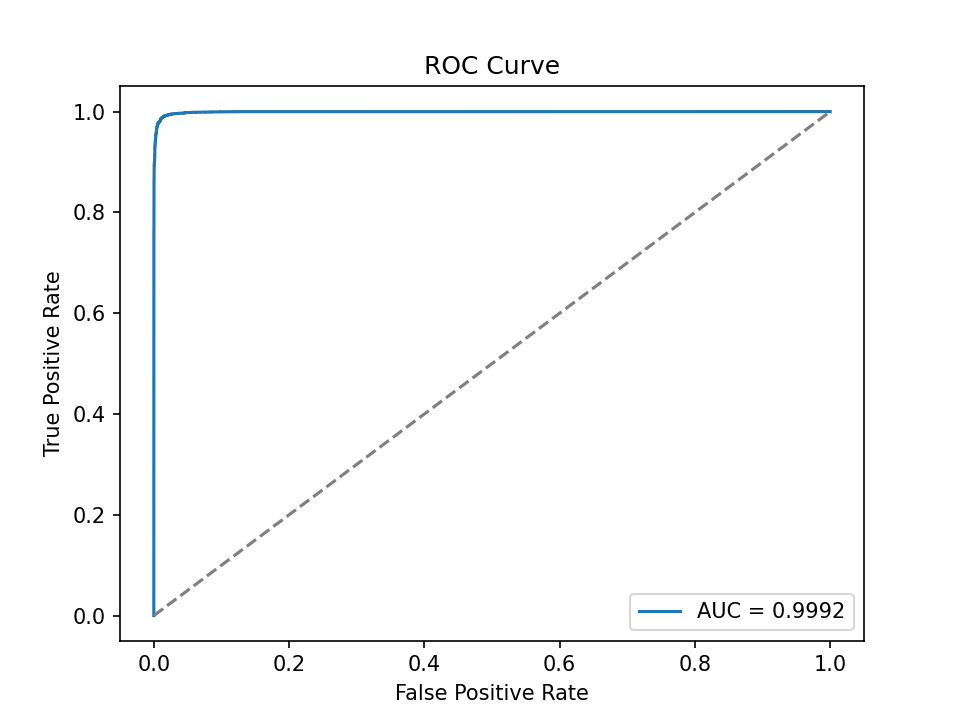
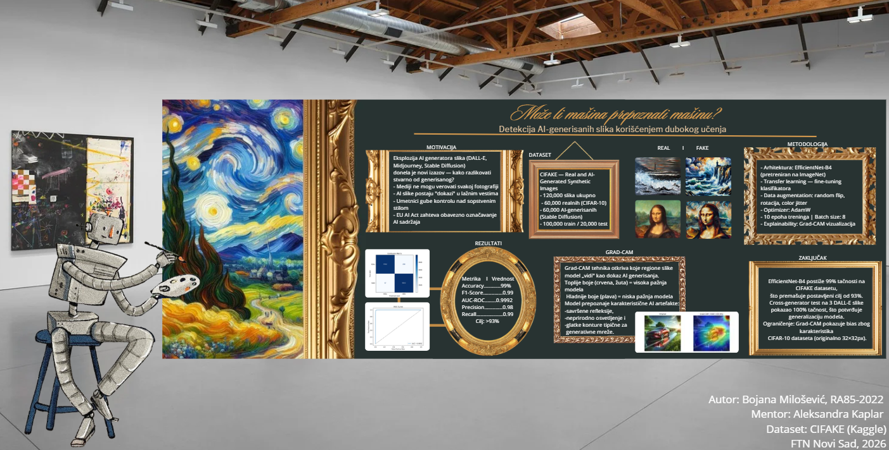

# Can a Machine Recognize a Machine?
### Detecting AI-Generated Images with Deep Learning

<p align="center">
  
</p>

> The system takes an image as input and classifies it as an **AI-generated image** or a **real photograph**, using transfer learning with EfficientNet-B4 and Grad-CAM visualization.

**Author:** Bojana Milošević, RA85-2022  
**Teaching assistant:** Aleksandra Kaplar  
**Course:** Soft Computing — FTN Novi Sad, 2026

---

## Note: this project is the starting point of my bachelor's thesis

This is a project from the Soft Computing course. The 99% result below is valid **only for the CIFAKE dataset**. When I later tested the model on other images, it turned out that this result does not carry over beyond CIFAKE (details in the section [What was found after the project](#what-was-found-after-the-project)).

That is why my bachelor's thesis investigates why this happens and how it can be fixed. The thesis is in progress, and the experimental part is finished.

---

## Results on the CIFAKE dataset

| Metric | Value |
|--------|-------|
| **Accuracy** | **99%** |
| F1-Score | 0.99 |
| AUC-ROC | 0.9992 |
| Precision (FAKE) | 0.98 |
| Recall (FAKE) | 0.99 |

These results were obtained on the CIFAKE test set, and the best model was selected on that same test set, so they are probably too optimistic.

### Confusion Matrix


### ROC Curve


---

## What was found after the project

I additionally tested the model on higher-resolution images:

- On real high-resolution photographs it was correct in only **6%** of cases (balanced accuracy about 50%), because it labeled almost everything as an AI image.
- A completely gray image, with no content at all, was classified as AI-generated with a probability of **0.999**.
- Grad-CAM highlighted the **upper-right corner** of every image, regardless of its content.

Conclusion: the model learned to tell CIFAKE images (32×32, upscaled) apart from other images, not real images from AI-generated ones.

### Bachelor's thesis: continuing the project

In my bachelor's thesis (*Detection of AI-Generated Images: Why Detectors Report Falsely High Accuracy and How to Prevent It*) I trained three new EfficientNet-B4 models on higher-resolution images, using images from the Stable Diffusion v1.5 generator only, and tested them on 6 more generators they did not see during training.

| Model | Training data | Purpose |
|-------|---------------|---------|
| A | tiny GenImage: AI images are PNG, real images are JPEG of varying quality | checks whether the model learns the file format instead of the content |
| B | Unbiased tiny GenImage: all images are JPEG quality 96 | main model |
| C | same as B + augmentation (JPEG 60–100, downscaling, blur) | robustness to images found on the internet |

Main findings:

- Each model was trained 3 times (seeds 42, 1 and 2). The differences between models are much larger than the differences between training runs, so the results are not random.
- Model A reaches 95.8% on its own test set, but on generators outside the Stable Diffusion family it drops close to random guessing. On a second dataset, even Model B drops to 56–89%.
- On clean images Model C is almost as good as B (98.0% vs. 98.6%), but it recognizes unseen generators worse. There is no single best model: B is better for clean images, and C for images as found on the internet.
- The corner in Grad-CAM is caused by zero padding. When I replaced the zeros with a reflection of the image (reflect padding) and retrained the model, attention in the upper-right corner dropped from 57% to 3%, with a small drop in accuracy on real images (from 97.9% to 94.9%).
- Grad-CAM is reliable only when the model classifies an image as AI. For real images the map only shows the corner.

Limitations: the models were trained on a single generator (1,750 AI images), the generators used date from 2022 and 2023, and I have not established why the corner appears specifically in the upper-right part of the image.

---

## Dataset (Soft Computing project)

**CIFAKE — Real and AI-Generated Synthetic Images** ([Kaggle](https://www.kaggle.com/datasets/birdy654/cifake-real-and-ai-generated-synthetic-images))

- 120,000 images in total (60,000 real + 60,000 AI-generated)
- Real images come from the CIFAR-10 dataset
- AI images generated with **Stable Diffusion**
- Split: 100,000 train / 20,000 test

---

## Methodology (Soft Computing project)

- **Architecture:** EfficientNet-B4 (pre-trained on ImageNet)
- **Approach:** Transfer learning — fine-tuning the classifier
- **Data augmentation:** random flip, rotation, color jitter
- **Optimizer:** AdamW | **Epochs:** 10 | **Batch size:** 8
- **Explainability:** Grad-CAM visualization

---

## Grad-CAM

Grad-CAM shows which regions of an image the model uses for its decision. In this project I originally interpreted this as proof that the model recognizes AI artifacts (perfect reflections, unnatural lighting, smooth contours). A later check showed that the maps were strongly influenced by the image corner, so they should be interpreted with caution.

---

## Cross-Generator Test

The model was trained on Stable Diffusion images and tested on **DALL-E** images (a car, a teddy bear, a woman), where it reached 100% accuracy. That was a test on only three images, so it does not prove generalization to other AI generators. The later evaluation on 7 generators (see above) is a more reliable indicator.

---

## Usage

### Installation
```bash
python -m venv venv
source venv/Scripts/activate  # Windows
pip install torch torchvision torchaudio --index-url https://download.pytorch.org/whl/cu118
pip install scikit-learn matplotlib numpy pillow tqdm grad-cam
```

### Training
```bash
python src/train.py
```

### Evaluation
```bash
python src/evaluate.py
```

### Predicting a single image
```bash
python src/predict.py "path/to/image.jpg"
```

### Grad-CAM visualization
```bash
python src/gradcam.py
```

---

## Project structure

```
ai-image-detection/
├── data/
│   ├── train/                  # 100,000 training images
│   ├── test/                   # 20,000 test images
│   └── cross_generator_test/   # DALL-E test images
├── models/
│   └── best_model.pth          # Best model (Epoch 9, 98.62%)
├── results/
│   ├── confusion_matrix.png
│   ├── roc_curve.png
│   └── gradcam_*.jpg
└── src/
    ├── dataset.py
    ├── model.py
    ├── train.py
    ├── evaluate.py
    ├── gradcam.py
    └── predict.py
```

---

## Limitations of the Soft Computing project

- The model was trained on CIFAR-10 images (originally 32×32 px), which leads to blurry visualizations
- The model does not work on images outside CIFAKE (6% accuracy on real high-resolution photographs)
- Grad-CAM shows a bias towards image corners (caused by zero padding)
- The best model was selected on the test set, which gives an overly optimistic result

---

## Poster

<p align="center">
  
</p>

[View the poster](https://www.canva.com/design/DAHCWm23Zeg/zkD0GKahKvSdYiU1y0RoWg/edit?utm_content=DAHCWm23Zeg&utm_campaign=designshare&utm_medium=link2&utm_source=sharebutton)
